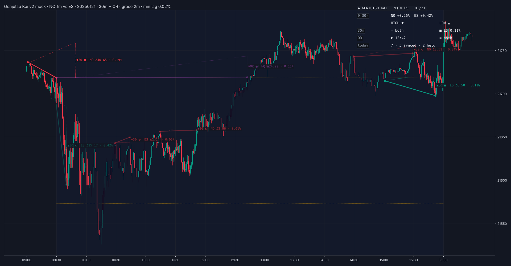

# Genjutsu Kai

**NQ / ES SMT divergences drawn as trendlines with a ghost of the sister market and sync odds**

TradingView indicator, Pine Script v6. Open source under the Mozilla Public License 2.0.

*Mock-up of how it looks on the chart.*

**Genjutsu Kai** (幻術解, "Genjutsu Release") is named for the technique that breaks an illusion. A run on one index can be an illusion: a high or low taken that the other index refuses to confirm.

Genjutsu Kai compares your chart with its sister market (NQ ↔ ES by default) in the regular session.

## What it draws

- **Each SMT** (crack in correlation, ICT) as a trendline from the reference high or low to the new extreme.
- **A ghost** of the other market's move, scaled onto your chart.
- **The lag:** the gap at the end of the ghost, showing how far the trailing market (the sick sister) is behind, in points and %.
- **The outcome:** each SMT either syncs (the sister takes its level too, so the move continues on both) or holds to the end of its window (the divergence stood).
- **References:**
  - 30-minute ranges;
  - hourly ranges anchored to 09:30;
  - the opening range (09:30–10:00, checked to 16:00).
- SMTs are only checked in RTH, 09:30–16:00 ET.

## HYDRA heads

Fitted on NQ / ES 1-minute data 2018–24, with a locked test on 2025–26:
- **sync odds:** the chance the sick sister still takes its level before the window ends, from its distance, its volatility and the time left;
- **a roll-week flag.**

## How to use

- Pairs itself on continuous charts (NQ1! ↔ ES1!) and single-contract charts (NQZ2026 ↔ ESZ2026).
- **View** sits at the top of the settings: theme and card text.

## Credits

- SMT, sick sister and opening range concepts are taught by ICT (Michael J. Huddleston).
- The trendline idea is inspired by "SMT Divergences" by LuxAlgo (CC BY-NC-SA 4.0).
- Written from scratch; no LuxAlgo code is used. Not affiliated with or endorsed by either.

## Add it to TradingView

1. In TradingView, open the **Pine Editor** (bottom panel).
2. Copy the contents of `Genjutsu_Kai.pine` into a new script.
3. **Save**, then **Add to chart**.

## License

Mozilla Public License 2.0, see [LICENSE](LICENSE). © Unclehk2000.

*Historical frequencies, not guarantees. Nothing here is financial advice.*
